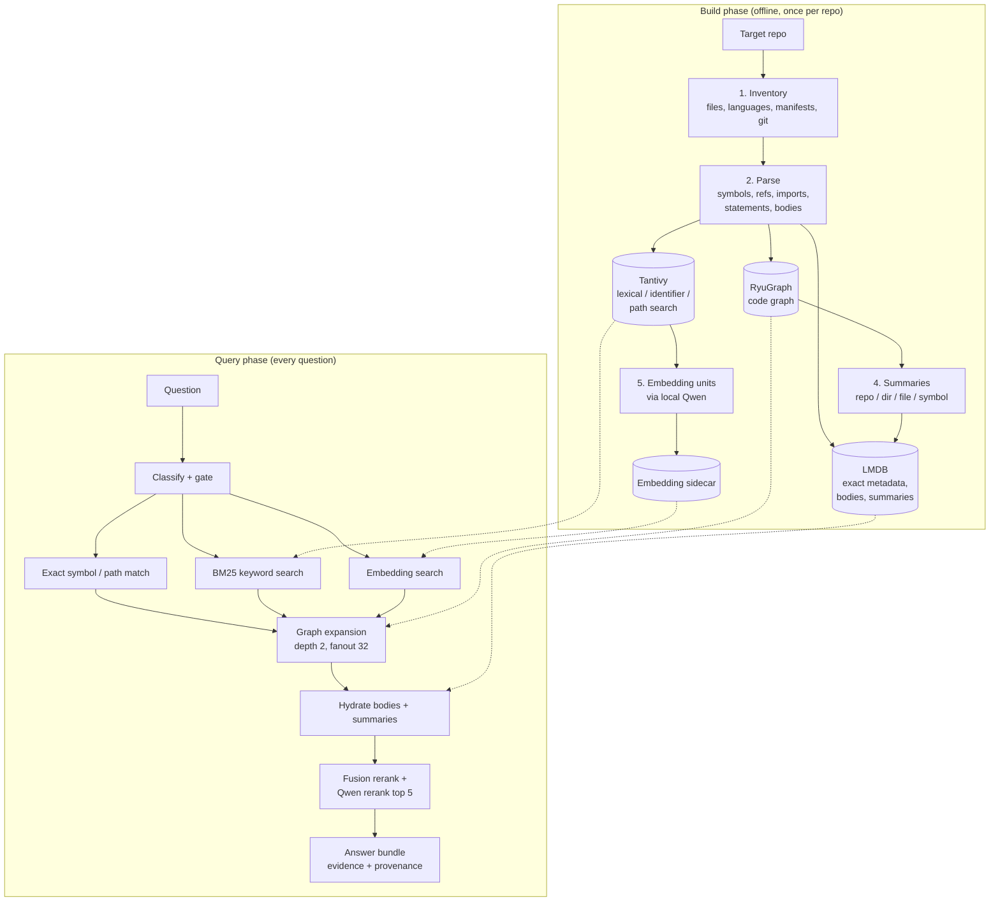

# repo-analysis-workbench: A Detailed Guide

> Source: https://github.com/prmartinow/repo-analysis-workbench (analysed at commit `8318147`; 22 commits between 11 and 27 June 2026, all by one author, `prmartinow`).
> Size: ~28k lines total; the bulk is Python under `src/`, plus a ~790-line Rust worker in `native/`.

---

## 1. What it is in one paragraph

`repo-analysis-workbench` is a **local code-intelligence and retrieval layer for LLM coding agents**. It runs once over a large source repository and turns it into a set of prebuilt, queryable artifacts: a file inventory, parsed symbols and statements, a keyword index, an exact-lookup store, a code graph, summaries and an embedding index. An agent (Claude, Codex) or a human then asks questions, and the workbench returns a **small, ranked, evidence-backed bundle** of the code that matters. The goal is to stop the model from blindly opening dozens of files.

It is **not** a coding agent, a chat UI or a hosted code-search service. It is the part that sits *underneath* an agent and decides what code the agent sees.

---

## 2. The core argument (the "why")

The design docs (`docs/Target Architecture.md`, `docs/Design & Requirements.md`) make one central claim:

> The problem is not mainly "better chunk retrieval". It is **cost-aware evidence acquisition over structured repository state.**

What that means in practice:

| Principle | Meaning |
|---|---|
| **Parser-first, not embedding-first** | Exact, parsed structure (symbols, references, call graph) is the source of truth. Embeddings are a sidecar signal. |
| **Smallest sufficient evidence set** | Give the agent the *fewest* pieces of code that are *enough*, not a top-k pile of chunks. |
| **Coarse-to-fine** | Start with cheap routes (exact match, keyword search, summaries) and only then pay for graph expansion, bodies and reranking. |
| **Structure beats surface text** | Defend against "textual bias", where code that merely *mentions* a word outranks code that actually *does* the thing. |
| **Fast repeated local queries** | Optimised for an agent asking many questions interactively on one machine, not for multi-user serving. |
| **Measure it** | Retrieval quality and token efficiency should be benchmarked, not assumed. |

---

## 3. Architecture at a glance



### The three runtime engines (a deliberate, "locked" design choice)

| Engine | Role | Typical questions |
|---|---|---|
| **Tantivy** (Rust full-text search engine) | Lexical, identifier and path search with BM25 ranking; generates retrieval "seeds" | "Which files mention retry backoff?", "find `RetryPolicy`" |
| **LMDB** (embedded key-value store) | Exact lookups: symbol by id, file by path, symbol bodies, summaries, artifact metadata, eval cache | "Give me the body of symbol #4821" |
| **RyuGraph** (embedded graph DB, a Kùzu fork) | Graph storage and traversal: neighbourhoods, paths, statement slices | "Who calls X?", "path from A to B", "what does Y write?" |

Plus two supporting pieces:
- **Embedding sidecar**: dense vectors over small code units. Mandatory in the current version.
- **Native Rust worker** (`native/src/main.rs`): hot-path helpers (`InspectRust`, `SearchFields`, `Span`, `NativeSymbol`) using tree-sitter-rust and Tantivy.

---

## 4. The build pipeline in detail

The target repos sit next to the workbench in one workspace directory (or are passed via `--workspace-root`). Nothing is vendored.

```
workspace/
  repo-analysis-workbench/
  target-repo/
```

| Step | Script | CLI command | Output (`data/…`) |
|---|---|---|---|
| 0 | `scripts/bootstrap.sh` | — | creates `data/{raw,parsed,graph,search,summaries,eval}` |
| 1 | `scripts/parse_repos.sh` | `parse-repos` | `data/raw/`: inventory |
| 2 | `scripts/build_index.sh` | `build-index` | `data/parsed/`, `data/graph/`: symbols and graph (resumable through a SQLite state file) |
| 3 | `scripts/build_search.sh` | `build-search` | `data/search/`: Tantivy indexes |
| 4 | `scripts/export_summaries.sh` | `build-summaries` | `data/summaries/`, synced to LMDB |
| 5 | `scripts/build_embeddings.sh` | `build-embeddings` | embedding sidecar under `data/search/` |
| 6 | `scripts/run_benchmarks.sh` | `run-benchmarks` | `data/eval/` |

All generated artifacts are gitignored.

### 4.1 Inventory (`src/common/inventory.py`)
- Walks the repo, detects language by file extension, and flags generated files.
- Reads manifests (`Cargo.toml` workspaces, `package.json`) to find packages, source roots and entrypoints.
- Records git metadata (commit, ref) and file SHA-1 hashes for caching.

### 4.2 Parsing (`src/parsers/`, `src/symbols/`)
Multiple **symbol providers**, each tagging records with a `provider` and a `confidence`:

| Provider | File | Depth |
|---|---|---|
| Rust static parser | `parsers/rust.py`, `rustc_backend.py`, `rust_analyzer_backend.py` | **Deepest**: types, traits, impls, statements, data flow |
| tree-sitter | `parsers/tree_sitter_backend.py` | Tags for Python, JS/TS, Go, Bash, YAML |
| Universal Ctags | `parsers/ctags_backend.py` | Broad, shallow symbol definitions |
| SCIP importer | `parsers/scip_backend.py` | Imports precise, compiler-grade indexes produced by external SCIP indexers |

`src/symbols/indexer.py` (~3,100 lines, the largest file) fuses these into one canonical record set: files, symbols, imports, references, statements and symbol bodies. Each record has a stable id, a path and line spans.

> **Takeaway:** Rust got first-class treatment from day one. Other languages were added later (commits dated 26 June 2026) through Ctags, tree-sitter and SCIP, and are noticeably shallower.

### 4.3 Graph (`src/graph/builder.py`, `src/backends/ryugraph/`)
Nodes are files, symbols, statements and references. Edge types found in the code:

`CONTAINS`, `DEFINES`, `DECLARES`, `CALLS`, `IMPORTS`, `REFERENCES`/`REFS`, `READS`, `WRITES`, `IMPLEMENTS`, `INHERITS`, `OVERRIDES`, `USES_TYPE`, `TYPE_DEFINITION`, `CONTROL_FLOW`, `DATA_FLOW`, `DEPENDENCE`, `TESTS`

This graph powers commands such as `callers-of`, `path-between` and `statement-slice`, and drives the "expansion" step at query time.

### 4.4 Search index (`src/search/indexer.py`, `src/backends/tantivy/`)
- Indexes code text, identifiers (split, so `retryHandler` matches "retry handler"), and paths.
- An optional **Zoekt** sidecar (`src/search/zoekt_backend.py`) exists purely to *compare* search backends (`compare-search-backends`).

### 4.5 Summaries (`src/summaries/builder.py`)
- Deterministic (rule-based, **not** LLM-generated) roll-ups at repo, package, directory, file and symbol level.
- Used for **routing**: read "this folder handles networking" before opening it.
- Non-Rust repos get "inventory fallback" summaries.

### 4.6 Embeddings (`src/embeddings/`)
- **No whole files are embedded.** `units.py` splits documents into bounded **retrieval units**:
  - `line_window` (code windows of at least 80 tokens)
  - `symbol_body` / `function_body` / `type_body`
  - `statement`
  - `doc_section` / summaries
- Each unit carries an **aggregation key**, so hits roll back up to their file or symbol using **maxp** (a parent's score is the score of its best unit).
- Providers (`providers.py`): `qwen` (default, local HTTP at `127.0.0.1:18200/v1/embeddings`), `openai`, and a non-model `hashing` fallback.
- Built for large repos: batched, with checkpoint/resume and heartbeat progress logging (the latest commits).

---

## 5. The query pipeline in detail

### 5.1 Standard path: `retrieve_context` (`src/retrieval/engine.py`)

**Step 1: Classify the query** (`classify_query`). Uses keyword hints to set flags: `explicit_docs`, `explicit_graph`, `explicit_body`, `explicit_statement`, `explicit_path`, `explicit_symbol` (e.g. `sym:` prefix, `::`, or a 1–2 word query). Intent becomes `docs`, `symbol` or `exploration`.

**Step 2: Selective retrieval gate** (`retrieval_gate`). Decides which expensive stages to run:

| Gate reason | When | Global symbol search | Graph | Bodies |
|---|---|---|---|---|
| `path-or-docs` | docs words or exact path hit | ✗ | ✗ | ✗ |
| `exact-symbol` | exact symbol hit, short query | ✗ | only if asked | only if asked |
| `statement-query` | statement hints / `@L` | ✓ | ✓ | ✓ |
| `exploration` / `generic` | everything else | if no summary hit | if exploratory | if exploratory |

Embeddings are queried in **every** case (`embeddings_required: True`).

**Step 3: Seed retrieval.** Exact symbol resolution, BM25 lexical search, scoped symbol search within the matching summary scopes, and embedding search.

**Step 4: Graph expansion** (`expand_graph_candidates`). Bounded walk from seed nodes: `max_depth: 2`, `max_fanout: 32` (`configs/retriever.yaml`). It skips noisy node kinds (statements, raw refs).

**Step 5: Hydration.** Pulls bodies, signatures and summary text from LMDB, and annotates each candidate with its scope and summary relevance.

**Step 6: Reranking** (`src/rerank/fusion.py`):
- A heuristic fusion of lexical, identifier, embedding and graph signals.
- Then a **Qwen reranker** (`127.0.0.1:18200/rerank`) on the top **5**.
- If the reranker is unreachable, the query **fails loudly**, unless `REPO_ANALYSIS_ALLOW_HEURISTIC_RERANK_FALLBACK=1` is set.

### 5.2 Planning and bundles (`src/retrieval/planner.py`)
- **`plan-query`**: picks a "recipe" (sequence of stages), seed types, recommended edge types for the intent, and stopping criteria.
- **`prepare-answer-bundle`**: runs retrieval and returns a compact package: the ranked evidence items, **provenance** ("why this was picked"), relevant summaries, and stopping info. This is the main agent-facing output.
- **`retrieve-iterative`**: refines the task with hints and retrieves again.

### 5.3 Paper-style staged mode (`src/retrieval/staged.py`, `search-paper-pipeline`)
An explicit evaluation mode modelled on repository-level neural retrieval papers:
1. Take a **large BM25 pool** (`REPO_ANALYSIS_PAPER_LEXICAL_POOL`).
2. Split hits into **retrieval units**.
3. Fuse embedding and source signals, with an exact-query boost and a penalty for generated or test files.
4. Choose a diverse pre-rank pool, then **rerank unit excerpts with Qwen in batches**.
5. **Aggregate with maxp** back to files or symbols, keeping the top 3 unit hits per parent as evidence.

---

## 6. Command reference (`python3 src/cli/main.py <command>`)

**Build:** `parse-repos`, `build-index`, `build-search`, `build-summaries`, `build-embeddings`, `build-zoekt`

**Lookup and search**

| Command | Purpose |
|---|---|
| `repo-overview` | High-level map of a repo |
| `find-symbol`, `find-file`, `where-defined` | Locate definitions |
| `search-lexical`, `search-zoekt`, `compare-search-backends` | Keyword search |
| `embedding-search` | Semantic search over units |
| `search-paper-pipeline` | Staged paper-style retrieval |
| `get-summary`, `summarize-path` | Read summaries |
| `get-symbol-signature`, `get-symbol-body`, `get-enclosing-context`, `adjacent-symbols` | Exact code access |
| `compare-repos` | Cross-repo comparison |

**Graph:** `callers-of`, `callees-of`, `trace-calls`, `who-imports`, `reads-of`, `writes-of`, `refs-of`, `implements-of`, `inherits-of`, `path-between`, `statement-slice`, `expand-subgraph`, `graph-query`

**Agent-facing:** `plan-query`, `prepare-context`, `prepare-answer-bundle`, `retrieve-iterative`

**Evaluation:** `run-benchmarks`, `export-benchmark-prompts`, `score-answer-bundles`, `score-external-answers`, `benchmark-interactive`

`src/agents/toolkit.py` wraps all of these as Python functions, so it is the natural place to bolt on an MCP server or other agent tool interface.

---

## 7. Evaluation harness (`src/evaluation/harness.py`)

### Benchmark cases
JSONL files under `data/eval/cases/` (e.g. `ai-tooling.jsonl`, against a repo called `agent-kit`):

```json
{"name": "...", "repo": "agent-kit", "task_type": "architecture_evidence",
 "query": "RPC owned durable state and client sync boundaries",
 "expected_paths": [".rulesync/rules/network-and-state.md", "..."],
 "expected_symbols": [], "expected_terms": ["RPCNode", "..."]}
```

### Metrics per run
- `mrr`, `ndcg`, `first_relevant_rank`
- `path_recall_at_k`, `symbol_recall_at_k`, `exact_hit`, expected path and symbol hits
- `avg_prepared_tokens` (estimated tokens of the bundle), `avg_files_opened`, `avg_latency_ms`
- `avg_bundle_score` / `avg_answer_score`, broken down by `task_type`

### Modes compared (`configs/benchmarks.yaml`)
`semantic_graph_rerank`, `semantic_graph_rerank_summaries`, `selective_on`, `selective_off` (plus `lexical_only` in practice).

### Caveats
- Answer "quality" inside the harness is **heuristic**: `synthesize_answer` and `grade_answer_quality` match expected terms. It is not an LLM judge.
- `score-external-answers` exists to score answers produced by an *external* agent. That is the hook for comparing against Claude Code, Cursor and similar tools.
- Results are cached in LMDB, keyed by an artifact fingerprint.

---

## 8. Configuration

**YAML (`configs/`)**
```yaml
# indexer.yaml
parsers: [tree-sitter, rust-analyzer]
# retriever.yaml
lexical: bm25
graph_expansion: {enabled: true, max_depth: 2, max_fanout: 32}
embeddings: {enabled: true, provider: qwen}
summaries: {enabled: true}
selective_retrieval: {enabled: true}
# summarizer.yaml
levels: [project, directory, file, symbol]
incremental: true
```

**Environment variables**

| Variable | Purpose |
|---|---|
| `REPO_ANALYSIS_EMBEDDING_PROVIDER` / `_MODEL` | `qwen` / `openai` / `hashing` |
| `REPO_ANALYSIS_QWEN_EMBEDDINGS_URL` | default `http://127.0.0.1:18200/v1/embeddings` |
| `REPO_ANALYSIS_QWEN_RERANK_URL` / `_LIMIT` | default `http://127.0.0.1:18200/rerank`, top 5 |
| `REPO_ANALYSIS_RERANK_PROVIDER` | choose the reranker |
| `REPO_ANALYSIS_ALLOW_HEURISTIC_RERANK_FALLBACK` | `1` lets queries run without the Qwen reranker |
| `REPO_ANALYSIS_PAPER_{LEXICAL,PRE_RANK,RERANK}_POOL` | pool sizes for the paper pipeline |
| `REPO_ANALYSIS_QWEN_HEARTBEAT_SECONDS` | progress logging during embedding builds |
| `REPO_ANALYSIS_ZOEKT_BIN` / `_INDEX_BIN` | Zoekt binaries for comparison |
| `OPENAI_API_KEY` | only if using the OpenAI embedding provider |

**Dependencies:** Python ≥ 3.10, `lmdb`, `ryugraph`; optional `tree-sitter` extras; a Rust toolchain for `native/`; optionally `universal-ctags`, Zoekt and a SCIP indexer; and **a running local Qwen inference service**.

---

## 9. Repository layout

```
repo-analysis-workbench/
├── README.md
├── docs/
│   ├── Overview.md                       # what it is, use cases
│   ├── Design & Requirements.md          # locked 3-engine design, design Q&A
│   ├── Target Architecture.md            # 7-layer target system + phased roadmap
│   ├── Multi-Language Code Intelligence Implementation Plan.md
│   ├── To-Do.md
│   └── Repo Eval.md                      # (unrelated) 32-dim checklist for data/streaming frameworks
├── configs/                              # indexer / retriever / summarizer / benchmarks YAML
├── scripts/                              # bootstrap + build_* + run_benchmarks shell wrappers
├── native/                               # Rust worker (tree-sitter-rust, tantivy)
├── src/
│   ├── cli/main.py                       # ~40 commands
│   ├── agents/toolkit.py                 # Python API over all commands
│   ├── common/                           # inventory, telemetry, text utils, native tool calls
│   ├── parsers/                          # rust, tree-sitter, ctags, scip, rust-analyzer
│   ├── symbols/                          # canonical symbol indexer + schema + persistence
│   ├── graph/                            # graph builder + query
│   ├── search/                           # Tantivy indexer + Zoekt sidecar
│   ├── summaries/                        # deterministic summaries
│   ├── embeddings/                       # retrieval units, providers, sidecar indexer
│   ├── retrieval/                        # engine (gate+stages), planner (bundles), staged (paper)
│   ├── rerank/fusion.py                  # heuristic fusion + Qwen rerank
│   ├── evaluation/harness.py             # benchmarks, metrics, scoring
│   └── backends/                         # lmdb/, tantivy/, ryugraph/ adapters
├── data/eval/cases/ai-tooling.jsonl      # benchmark cases
└── tests/                                # 16 unit-test files + a Rust golden snapshot
```

---

## 10. Project status and history

**Commit trajectory (oldest → newest).** Most of the code arrived in one initial commit on 11 June; everything after it was committed in two days, 26–27 June 2026.
1. Initial baseline: Rust-first parsing, 3-engine runtime, summaries, graph.
2. "Require local semantic retrieval path": embeddings become mandatory.
3. Multi-language push: benchmark case loading → generalised symbol records → Ctags → inventory fallback summaries → tree-sitter → SCIP → Zoekt comparison.
4. Scale hardening: batch observability, removed timeouts, hashed overlong LMDB keys, capped graph fanout.
5. Retrieval-unit embeddings → paper-style staged retrieval → resumable Qwen batches with heartbeat.

**Self-declared status** (in the multi-language plan): *"Overall status: not complete."* The next milestone is benchmark reports on AI-tooling repos. Earlier embedding runs that embedded whole documents failed with timeouts and oversized payloads, which is why the code moved to retrieval units.

**Open to-do items** (`docs/To-Do.md`): configurable LMDB map size and repo list; staged repo → file → symbol retrieval; feeding test failures into retrieval; interprocedural flow analysis; seeding graph expansion from embeddings; end-to-end incremental rebuilds; and eventually "refactor repo-analysis into Rust".

---

## 11. Target architecture (where it wants to go)

`docs/Target Architecture.md` describes a 7-layer system run by a cost-aware controller:

1. **Artifact ingestion**: parser-first, incremental, stable ids.
2. **Repository IR and multi-view graph**: add code↔test, build/dependency, change-impact, history and runtime views.
3. **Retrieval and localisation**: coarse-to-fine, anti-textual-bias reranking.
4. **Evidence-set construction**: *smallest sufficient set*, token budgets, sufficiency estimation with stop/continue decisions.
5. **Repository-native memory**: subsystem notes, localisation trails and design commitments that persist across tasks.
6. **Execution and verification signals**: tests, traces, CI and coverage feed into ranking.
7. **Evaluation and observability**: separate retrieval quality from generation quality; measure prompt efficiency and the rate of harmful context.

**Phases:** 0 stabilise the core → 1 retrieval quality → 2 multi-view graph → 3 sufficiency control → 4 memory → 5 execution-aware loop.

---

## 12. Strengths and weaknesses

### Strengths
- **Real structure, not just text.** A call/read/write/data-flow graph enables relational questions ("who calls X, 3 hops up") that grep-based agents answer only slowly.
- **Explainable output.** Every bundle item carries provenance.
- **Thoughtful cost control.** A selective gate, bounded expansion, a small rerank window and unit-level embeddings instead of whole files.
- **Built-in evaluation.** Recall, MRR, nDCG, token and latency metrics, and a hook for scoring external answers.
- **Engineered for big repos.** Resumable builds, batching, checkpointing and hashed keys.

### Weaknesses and risks
- **Uneven language depth.** Rust gets deep analysis; Python, TS and Go get mostly symbol tags with a thinner graph.
- **Hard dependency on a local Qwen server** for both embeddings and reranking.
- **No end-to-end incremental rebuild**, so changes mean expensive re-indexing on large repos.
- **Shallow summaries.** They are deterministic roll-ups, not semantic descriptions of intent.
- **No sufficiency estimation yet,** which the project's own docs name as the most important gap.
- **Heuristic answer grading** in the harness. A real comparison needs an LLM or human judge.
- **No agent integration shipped.** There is no MCP server; an agent would have to call the CLI or `toolkit.py`.
- **Early stage.** It is a single-author prototype, with benchmark reports still pending.

---

## 13. How it relates to existing agent harnesses

| | Claude Code (default) | Cursor | repo-analysis-workbench |
|---|---|---|---|
| Retrieval style | Agentic: grep / glob / read in a loop | Embedding index + agent tools | Parsed metadata + BM25 + graph + embeddings + rerank |
| Pre-indexing | None | Yes (embeddings) | Heavy (parse, graph, search, summaries, embeddings) |
| Structural queries | Via repeated searches | Limited | First-class graph operators |
| Is it a full agent? | Yes | Yes | **No**: a retrieval layer to plug *into* an agent |

**How to compare it fairly:** use the same harness and model with and without the workbench (for example, Claude Code alone vs. Claude Code with the workbench as an MCP tool). Measure retrieval recall/MRR, answer correctness, and cost (tokens, turns, time). Any advantage is most likely on **large repos** and **structural or cross-file questions**.

---

## 14. Quick start (once dependencies and Qwen are available)

```bash
./scripts/bootstrap.sh
./scripts/parse_repos.sh      --repo target-repo
./scripts/build_index.sh      --repo target-repo
./scripts/build_search.sh     --repo target-repo
./scripts/export_summaries.sh --repo target-repo
./scripts/build_embeddings.sh --repo target-repo --provider qwen --model text

python3 src/cli/main.py repo-overview         --repo target-repo
python3 src/cli/main.py callers-of            --repo target-repo "SomeSymbol"
python3 src/cli/main.py prepare-answer-bundle --repo target-repo "How does retry handling work?"
```
